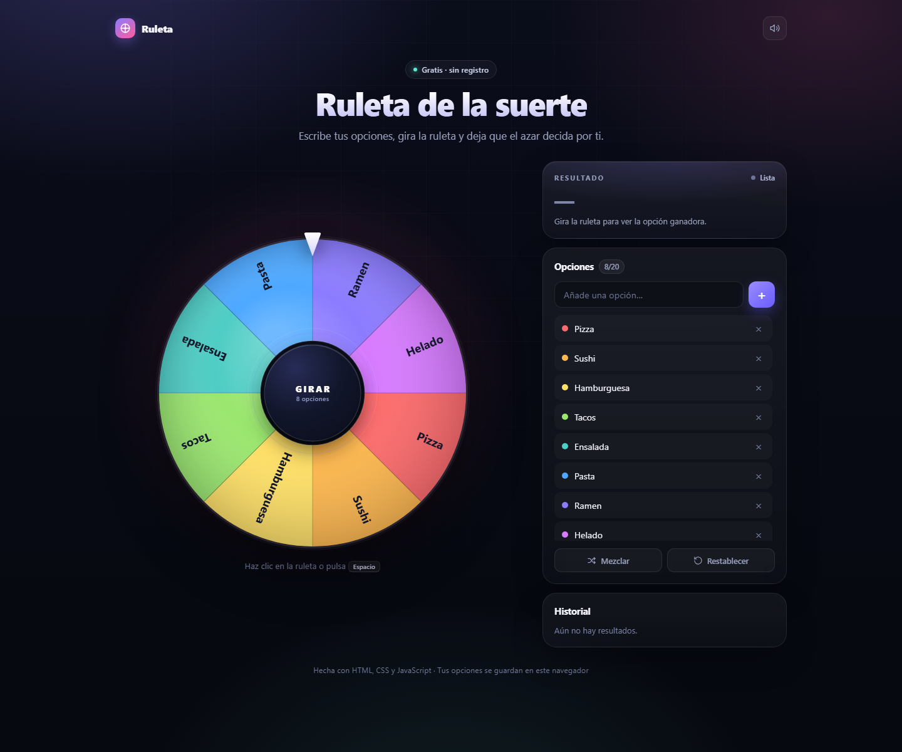

# Ruleta de la Suerte

Aplicación web de una ruleta aleatoria, hecha con HTML, CSS y JavaScript puro. No necesita instalación, compilación ni dependencias: son archivos estáticos listos para subir a cualquier hosting.



## Funciones

- Ruleta animada con física de frenado suave y sonido de tics (se puede silenciar).
- Opciones editables: añadir, eliminar, barajar y restablecer.
- Resultado destacado, confeti de papel e historial de los últimos veredictos.
- Dos temas, día y noche, con conmutador y preferencia guardada. La primera visita sigue el tema del sistema.
- Persistencia en `localStorage`: opciones, historial, sonido y tema se conservan al recargar.
- Atajos de teclado: `Espacio` para girar, `Enter` para añadir una opción.
- Diseño responsive para móvil, tableta y escritorio.
- Accesible: navegación por teclado, foco visible, etiquetas ARIA y respeto a `prefers-reduced-motion`.
- Versión en inglés en `en/index.html`, con enlace para cambiar de idioma.

## Archivos

```
index.html          Estructura y contenido (español)
en/index.html       Estructura y contenido (inglés)
styles.css          Sistema visual, temas y animaciones (compartido)
app.js              Lógica de la ruleta (español)
en/app.js           Lógica de la ruleta (inglés)
assets/fonts/       Unbounded y Manrope autoalojadas (woff2)
doc/                Documentación funcional y técnica
DESIGN.md           Sistema visual: tokens, tipografía y componentes
PRODUCT.md          Propósito, público y criterios de producto
preview.png         Captura de la interfaz
```

La documentación detallada del proyecto está en [`doc/README.md`](doc/README.md).

## Uso local

Abre `index.html` con doble clic. Para probarla con un servidor local:

```bash
# Opción 1: Python
python -m http.server 8000

# Opción 2: Node.js
npx serve .
```

Luego visita `http://localhost:8000`.

## Publicarla en internet

Es un sitio 100 % estático. Cualquiera de estas opciones funciona:

- **Netlify Drop**: arrastra la carpeta a https://app.netlify.com/drop.
- **GitHub Pages**: sube los archivos al repositorio y activa Pages en *Settings → Pages*.
- **Vercel**: importa el repositorio y despliega sin configuración adicional.
- **Cualquier hosting compartido**: sube todo el contenido del repositorio por FTP a la carpeta pública.

La versión en inglés vive en la carpeta `en/`. Al desplegar, queda disponible en `https://tu-dominio.com/en/` y comparte `styles.css` y `assets/fonts/` con la versión española.

## Personalización

En `app.js` puedes cambiar:

- `DEFAULT_OPTIONS`: las opciones que aparecen la primera vez.
- `THEMES`: las paletas de día y noche que usan la ruleta, los puntos y el confeti.
- `COPY`: todos los textos de la interfaz.
- `MAX_OPTIONS`: el límite de opciones (20 por defecto).
- `STORAGE_KEY`: la clave usada para guardar en el navegador.

En `en/app.js` están los mismos ajustes para la versión en inglés, con su propia `STORAGE_KEY` para que cada idioma conserve sus opciones por separado.

En `styles.css`, los tokens de `:root` definen la edición de día y `[data-theme="night"]` la de noche: fondo, superficies de vidrio, texto, acentos, degradados, aurora y tipografías. La estructura y los componentes usan esos tokens, así que un cambio de paleta afecta a ambos temas y a los dos idiomas.
