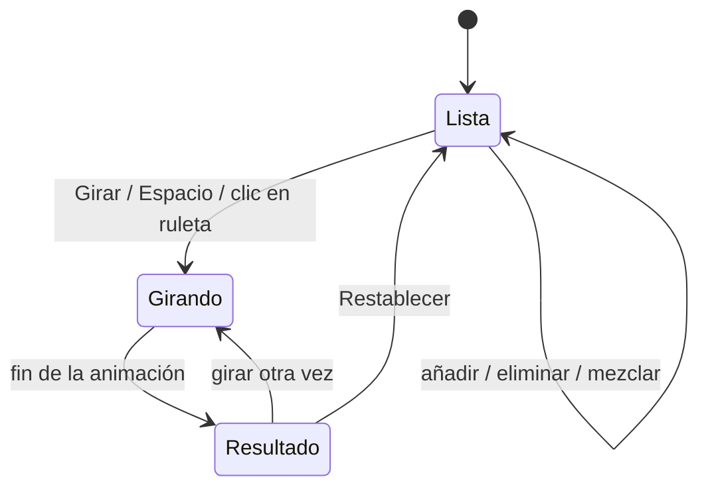

# 01 · Visión general

## 1. Propósito

**Ruleta de la Suerte** (en inglés, **Spin the Wheel**) es una herramienta de decisión: el usuario
escribe una lista de opciones (qué comer, quién paga, qué película ver…) y la aplicación elige una al
azar mediante una ruleta animada.

Está pensada para funcionar **sin cuenta, sin backend, sin instalación y sin conexión** una vez
cargada. Todo el estado vive en el navegador.

El proyecto ofrece **dos versiones equivalentes**:

| Idioma | Página | Lógica | Clave de datos |
| --- | --- | --- | --- |
| Español (`es`) | `/es/` (`public/es/index.html`) | `public/app.js` | `ruleta-de-la-suerte:v1` |
| Inglés (`en`) | `/en/` (`public/en/index.html`) | `public/app.js` | `spin-the-wheel:v1` |

Ambas páginas viven en el mismo dominio. La lógica y el CSS son únicos: `app.js` toma los textos del
idioma indicado en `<html lang>`. La portada `/` redirige al idioma recordado o al del navegador. El
cambio de idioma es un enlace normal que recarga la otra página; **no** traduce al vuelo ni comparte
opciones entre idiomas.

## 2. Público y propuesta de valor

| Aspecto | Detalle |
| --- | --- |
| Público | Cualquier persona con un navegador moderno, en móvil o escritorio, en español o inglés |
| Registro | No requiere cuenta ni datos personales |
| Coste | Ninguno |
| Valor diferencial | Inmediatez: abrir y girar; sin dependencias ni esperas |
| Idiomas | Dos documentos independientes, cada uno con su `lang`, metadatos y textos |

## 3. Funciones actuales

| Función | Comportamiento real | Dónde está |
| --- | --- | --- |
| Ruleta animada | Dibujada en `<canvas>` con giro de 5–7 vueltas y frenado suave (ease-out cuártico) | `app.js` → `spin`, `draw` |
| Selección aleatoria | Índice ganador uniforme entre las opciones; el giro se calcula para que el puntero caiga dentro de esa porción con una pequeña variación | `spin()` |
| Sonido de tics | Sintetizado con Web Audio mientras pasan porciones; arpegio final al terminar | `playTick`, `playFanfare` |
| Silenciar | Botón en la cabecera; el estado se guarda por idioma | `soundBtn`, `updateSoundUI` |
| Añadir opción | Formulario; recorta a 40 caracteres y normaliza espacios; máximo 20 opciones | `addOption` |
| Eliminar opción | Botón `×` por fila | `removeOption` |
| Mezclar opciones | Barajado Fisher–Yates de la lista (no del dibujo) | `shuffleOptions` |
| Restablecer | Vuelve a las 8 opciones por defecto, borra historial y resultado; pide confirmación | `resetAll` |
| Resultado destacado | Pliego con el ganador, su color de porción y una animación de aparición | `finishSpin` |
| Confeti | 100 flecos de papel en escritorio, 60 en móvil; desactivado con movimiento reducido | `burstConfetti` |
| Historial | Últimos resultados como *chips* con su color; se muestran 10 y se guardan 12 | `renderHistory` |
| Persistencia | Opciones, historial y silencio sobreviven a la recarga, por idioma; el tema se guarda aparte | `loadState`, `saveState` |
| Tema día / noche | Conmutador en la cabecera, preferencia guardada y seguimiento de `prefers-color-scheme` en la primera visita | `setTheme`, `toggleTheme` |
| Cambio de idioma | Enlace `EN`/`ES` en la cabecera; navega a la otra página y recuerda la elección (`wheel-lang`) | `.lang-link` |
| Atajos | `Espacio` gira; `Enter` dentro del campo añade una opción | `keydown`, `<form>` |
| Responsive | Dos columnas en escritorio; una columna en tableta/móvil | `styles.css` |
| Accesibilidad | Foco visible, etiquetas ARIA, `aria-live` en el resultado, respeto a `prefers-reduced-motion` | ver documento 05 |

## 4. Flujo de usuario

1. La app arranca con 8 opciones de ejemplo (o con las guardadas previamente en ese idioma).
2. El usuario añade, elimina o mezcla opciones en el panel derecho.
3. Pulsa **GIRAR / SPIN**, hace clic en la ruleta o pulsa `Espacio`.
4. La ruleta gira; el estado pasa a «Girando» / «Spinning» y el resultado muestra `…`.
5. Al detenerse, se revela el ganador con fanfarria, confeti y color propio.
6. El resultado se añade a la cabecera del historial y todo se guarda.
7. El usuario puede girar otra vez, restablecer todo o cambiar de idioma con el enlace `EN`/`ES`.

Estados reales del DOM: `#resultCard[data-state]` toma `idle`, `spinning` y `done`.
El cambio de idioma es una navegación completa, no un estado de la aplicación.

## 5. Casos de uso típicos

- Decidir un restaurante entre varias opciones.
- Sortear quién paga o quién empieza un juego.
- Elegir una tarea o un tema al azar.
- Uso en el aula o en una reunión, proyectando la pantalla.
- Publicar la misma herramienta para audiencias hispanohablantes y angloparlantes.

## 6. Alcance

### Incluido

- Ejecución 100 % en cliente, incluso abriendo los archivos con `file://`.
- Datos privados por navegador e idioma: no se envían a ningún servidor.
- Funcionamiento sin conexión tras la primera carga (si se sirve con caché normal del navegador).
- Dos idiomas completos con metadatos `hreflang` y `og:locale`.
- Cambio de idioma mediante enlaces relativos (`../en/`, `../es/`), sin depender de reglas del servidor.

### No incluido

- Traducción dinámica ni un sistema i18n completo; los textos del HTML están duplicados en cada página
  y los del JS viven en `LANGS`.
- Sincronización de opciones entre idiomas (cada uno tiene su propia clave).
- Sincronización entre dispositivos o pestañas.
- Cuentas, backend, base de datos o analítica.
- Ruletas con pesos/probabilidades configurables.
- Varias ruletas o guardado de listas con nombre.
- Compartir una lista mediante URL.
- Más idiomas o PWA.

## 7. Requisitos

| Requisito | Nivel |
| --- | --- |
| Navegador | Moderno tipo *evergreen*: Chrome/Edge 111+, Firefox 113+, Safari 16.4+ recomendado (por `color-mix()`); el resto de la app funciona en versiones algo anteriores |
| JavaScript | Obligatorio; hay un aviso `<noscript>` en ambos idiomas |
| `localStorage` | Opcional: si está bloqueado, la app funciona pero no recuerda datos |
| Web Audio | Opcional: si no existe, no hay sonido |
| Canvas 2D | Obligatorio para dibujar la ruleta |
| ResizeObserver | Opcional: sin él, la ruleta se redimensiona solo al cambiar el tamaño de ventana |
| Conexión | Solo para la primera descarga de los archivos y las fuentes autoalojadas |

## 8. Glosario

| Término | Significado en este proyecto |
| --- | --- |
| **Opción / option** | Cada texto de la lista; también cada porción de la ruleta |
| **Porción / segmento / slice** | Sector circular de la ruleta; ángulo `2π / nº de opciones` |
| **Puntero / pointer** | Triángulo fijo en la parte superior que marca el resultado |
| **Hub** | Botón circular central con el texto «GIRAR» / «SPIN» |
| **Giro / spin** | Animación que modifica la variable `rotation` hasta alinear al ganador |
| **Tick** | Sonido corto que se reproduce al cruzar el puntero una frontera de porción |
| **Confeti / confetti** | Partículas dibujadas en un segundo canvas a pantalla completa |
| **Chip** | Píldora del historial con punto de color y etiqueta |
| **Toast** | Mensaje flotante temporal (p. ej. «Opciones mezcladas» / «Options shuffled») |
| **Lang switch** | Enlace de la cabecera que lleva a la versión en el otro idioma |
